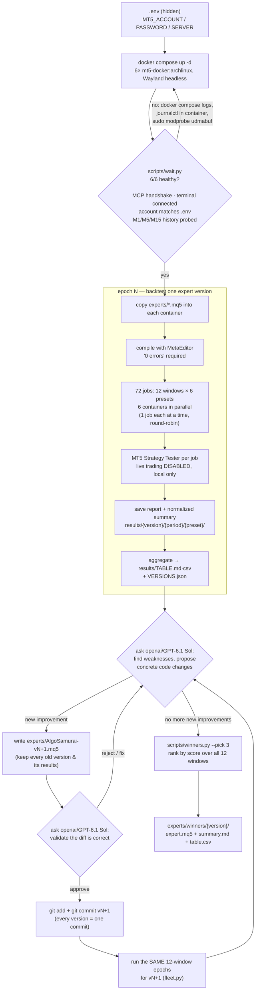

# mt5-algo-trader

Run and improve the [`AlgoSamurai`](experts/AlgoSamurai/) MT5 expert on a
fleet of **6 Arch Linux MT5 containers** (Wayland, headless) from
[skynet-core/mt5-docker](https://github.com/skynet-core/mt5-docker).

Loop: backtest a version over an epoch of 12 independent time windows
(4 matrices × 6 presets) → analyze weaknesses → improve → validate → commit →
retest → repeat until no new improvements → pick the top 3 into
[`experts/winners/`](experts/winners/).

Expert source changes are tracked with **git commits** (one per version);
`results/` artifacts are gitignored — evidence stays on disk only.

## Layout

```
.
├── .env                 # hidden: MT5_ACCOUNT / MT5_PASSWORD / MT5_SERVER (chmod 600, never commit)
├── docker-compose.yml   # 6x mt5-docker:archlinux, Wayland headless, mt5-mcp on 127.0.0.1:8001..8006
├── matrices/            # adjustable test matrices (12 independent windows total)
│   ├── m1.json … m4.json  # each: 3 distinct 12–24 M windows + 6 tester presets
├── pyproject.toml       # uv project (host-side MCP client)
├── experts/
│   ├── AlgoSamurai/     # every expert source version, stored in place
│   │   ├── 1.10.mq5     #   baseline
│   │   ├── 1.20.mq5     #   later improved versions (created by the loop)
│   │   └── …            #   one file per version: <version>.mq5
│   └── winners/         # final top 3: source + results + summary (created by winners.py)
├── .opencode/skills/    # reviewer/validator + math/statistics/trading skills for the loop
├── results/             # created by fleet.py
│   ├── TABLE.md         # grouped by expert_version/time_period
│   ├── table.csv        # flat rows
│   ├── index.html       # human-friendly index; every job links to its report
│   ├── VERSIONS.json    # version -> source, sha256, matrices, git_head, best row
│   └── <version>/<window-id>/<preset>/
│       ├── meta.json        # expert sha256, settings, container, timestamps
│       ├── summary.json     # normalized stats + score
│       ├── summary-raw.json # full reporter summary
│       ├── trades.tsv       # observation-only open/close log written by the EA
│       ├── report.html      # generated: cards + interactive SVG trade chart (reportgen)
│       ├── report.htm       # original MT5 report
│       ├── tester.ini       # the exact tester config used
│       └── error.txt        # only on failure
└── scripts/
    ├── mt5lib.py        # shared: MCP client, wine helpers, tester run, aggregation
    ├── reportgen.py     # human-friendly HTML (report/index) + SVG trade chart
    ├── wait.py          # fleet health gate (exit 0 = ready)
    ├── backtest.py      # run ONE job on ONE container
    ├── fleet.py         # run the whole matrix on 6 containers + aggregate
    └── winners.py       # rank versions, copy top 3 to experts/winners/
```

## Setup (once)

```sh
cp .env.example .env && chmod 600 .env      # or reuse ../mt5-docker/.env
EDITOR=.env; vi .env                        # MT5_ACCOUNT, MT5_PASSWORD, MT5_SERVER
uv sync
docker compose config -q                    # sanity check the compose file
```

Requires: Docker + `uv` (host), and the `ghcr.io/skynet-core/mt5-docker:archlinux`
image (pull it first: `docker pull ghcr.io/skynet-core/mt5-docker:archlinux`).

## Quick start (the whole pipeline)

```sh
docker compose up -d                        # 6 archlinux containers, Wayland headless
uv run scripts/wait.py --timeout 2400       # health gate: 6/6 = exit 0
uv run scripts/fleet.py --expert experts/AlgoSamurai/1.10.mq5 --name AlgoSamurai-1.10
# ... improvement loop (see "Agent protocol") ...
uv run scripts/fleet.py --expert experts/AlgoSamurai/1.20.mq5 --name AlgoSamurai-1.20
uv run scripts/winners.py --pick 3          # -> experts/winners/<version>/
```

## How it works

- **Containers.** `docker-compose.yml` sources the hidden [`.env`](.env) (Compose
  reads `.env` natively) and starts 6 instances of
  `ghcr.io/skynet-core/mt5-docker:archlinux` with `DISPLAY_BACKEND=wayland`
  `DISPLAY_MODE=headless`. Each gets a private Wine volume, `1920x1080`
  KWin output and three 127.0.0.1-only ports:

  | port (host) | service |
  |---|---|
  | `800<i>` | package MCP — `mt5-mcp` 0.6.3, endpoint `http://127.0.0.1:800<i>/mcp` |
  | `2300<i>` | native MT5 MCP proxy |
  | `240<i>` | MetaEditor MCP proxy |

- **Host connection.** `scripts/*` run under `uv` (project deps: `mcp` SDK) and
  talk to each container's `mt5-mcp` MCP endpoint for health, terminal,
  account and history probes. No MetaTrader5 Python package is needed on the
  host — the in-container MCP server owns that.

- **Backtest.** The Strategy Tester is driven inside the container via MT5's
  documented `/config` interface (same mechanism as upstream `tests/validate.py`):
  compile the expert with `metaeditor64.exe /compile` (must show `0 errors`),
  write a `tester.ini` per job, merge credentials in-container, disable live
  trading (`AllowLiveTrading=0`), freeze the kiosk supervisor, launch
  `terminal64.exe /config:...`, harvest `report.htm`, unfreeze and restore
  `mt5-mcp.service`. One terminal owner per container → one job per container
  at a time, 6 in parallel.

- **Matrices** ([matrices/](matrices/)) — adjustable, explicit windows defined
  in `matrices/m1…m4.json` (each file: 3 distinct 12–24-month windows, ids like
  `m1-12M-a`; 12 windows in total, no id repeats). Every version runs the SAME
  window set so results are comparable — that is the only "fixed" part. Add or
  edit a matrix file before a campaign to change what gets tested; never edit
  mid-campaign. Each window runs all 6 presets:

  Tester models: `1` = every tick from real recorded ticks (includes real
  spread/quote delay), `2` = every tick (OHLC, idealized fills). **All presets
  use the hard constraint: 1000 USD initial deposit, max leverage 1:30** →
  **72 jobs per version** (12 windows × 6 presets), 6 in parallel. The matrix
  files themselves are the source of truth.

- **Scoring.** Rows with `<100 trades` or net loss are disqualified (DQ).
  `score = 20 · (net P/L ÷ max drawdown) + 10 · min(profit factor, 5)`;
  zero-drawdown profit earns a 1000 base. A **version's** score is the mean of
  its best-preset score per window (each window is an independent sample),
  computed by `winners.py` over all versions in `results/`.

## Flow (human + agent readable)



## Agent protocol (deterministic)

Act as an autonomous agent when asked to run the loop. Rules:

1. **Preflight (idempotent).** `docker compose up -d`; then
   `uv run scripts/wait.py --timeout 2400`. Continue only on exit 0.
   On failure: read `docker compose logs <bad>`,
   `docker exec <bad> journalctl -b -u plasma-session.service -u mt5-mcp.service`,
   ensure `sudo modprobe udmabuf`, then retry once. Still failing → stop and report.
2. **Epoch.** `uv run scripts/fleet.py --expert <path> --name <version-tag>`.
   Exit code 0 = 72/72 jobs OK. 3 = partial (inspect `error.txt` per job,
   optionally re-run single jobs with `scripts/backtest.py --container …`).
3. **Analyze (LLM gate, round 1).** Spawn a reviewer subagent on
   `openai/GPT-6.1 Sol` with the **`algo-analyze`** skill (it loads the
   `math`, `statistics`, `trading` skills): provide `results/TABLE.md`, the
   expert source and the diff to the previous version (if any). It must return
   a ranked list of concrete code changes (≤5) with rationale. No other action
   until it names specific changes.
4. **Implement.** Apply only approved changes to a **new file**
   `experts/AlgoSamurai/<next>.mq5` (next = highest existing + 0.10); bump
   `#property version`; never rewrite an already-tested version file.
5. **Validate (LLM gate, round 2).** Spawn a validator subagent on
   `openai/GPT-6.1 Sol` with the **`algo-validate`** skill: line-by-line diff
   check against MQL5 semantics, the 1000 USD / 1:30 constraint, lot math and
   broker distance handling. If it rejects → back to step 4.
6. **Commit (only after approval).**
   `git add experts/AlgoSamurai/<next>.mq5 && git commit -m "<next>: <what changed>"`.
   Every tested version must exist as exactly the bytes of one commit —
   `VERSIONS.json` records its `git_head` so results map back to git history.
7. **Repeat 2–6** while the reviewer still proposes concrete,
   plausible improvements and fewer than **3 profitable variants** exist
   (a version is *profitable* when its window score beats its baseline and at
   least half its windows show a net profit). Stop conditions: no new
   proposals, or ≥3 profitable variants to compare.
8. **Finalize.** `uv run scripts/winners.py --pick 3` → top 3 versions land in
   `experts/winners/<version>/` with source + results + summary. Report the
   ranking table and which versions were chosen.

**Invariants (never break these):**

- Demo account only; tester config always has `AllowLiveTrading=0`; no live orders.
- **Core algorithm is sacred: every improved version must keep the original
  AlgoSamurai behavior — pending buy-stop/sell-stop entries, trailing stop
  loss, time/session filters and risk-based lot sizing — working the same way.
  Changes are parameter/filter/exit tuning and hardening of THAT logic, never
  a replacement of it (no new strategy, no different order flow).**
   - Sanctioned exception: the observation-only trade-event logger
     (`InpTradeLog`, `OnTradeTransaction`) only writes `trades.tsv`; no trading
     logic reads it, so it does not alter behavior.
- **Hard constraint: initial deposit 1000 USD, max leverage 1:30** — enforced
  by the preset values in `matrices/*.json`; do not run any version with
  different account settings.
- One tester job per container at a time (the fleet scheduler enforces it).
- Never delete or edit old `results/` or old expert versions; every version stays reproducible via its sha256 in `meta.json`.
- Never overwrite an already-tested `experts/AlgoSamurai/<v>.mq5`; new versions only.
- One expert version = one git commit; never amend or rewrite an already-tested version's commit.
- Don't modify `matrices/` mid-campaign — comparability depends on it.
- All evidence lives under `results/`; winners only under `experts/winners/`.
- If a container is unhealthy mid-flight, skip it (remaining 5 still work) and note it in the final report.

## Troubleshooting

| Symptom | Fix |
|---|---|
| `healthy` never reached | KWin needs `sudo modprobe udmabuf` (software rendering), then `docker compose up -d` again |
| `terminal not connected` | first boot downloads broker data — `wait.py` covers it; check `docker compose logs` |
| `insufficient M1/M5 history` in wait.py | **warning only** — the tester fetches data via its own path and still trades M1/M5 (verified); if a job shows zero bars instead, see `error.txt` + `tester-process.log` |
| report shows zero bars | symbol/period mismatch or history missing — see `error.txt` + `tester-process.log` |
| port in use (`8001…8006`, `23001…`, `24001…`) | another instance of this fleet is running — `docker compose down` first |

**Not checked / known risks:** M1 depth on the demo broker for the 2-year
window; 2-year every-tick runs may take > 1 h per container (timeout is 2 h).
